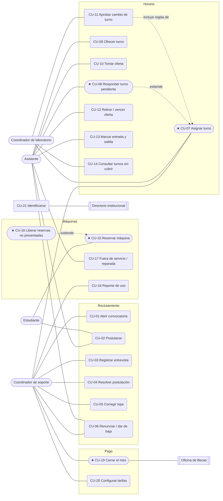

# 2. Casos de uso

## 2.1 Diagrama general

★ = implementado de punta a punta en el núcleo ejecutable.

## 2.2 Catálogo

| CU | Nombre | Actor principal | Nivel de detalle |
|----|--------|-----------------|------------------|
| CU-01 | Abrir convocatoria | Coord. soporte | Breve |
| CU-02 | Postularse | Estudiante | Breve |
| CU-03 | Registrar entrevista | Coord. soporte | Breve |
| CU-04 | Resolver postulación | Coord. soporte | Breve |
| CU-05 | Corregir tope semanal | Coord. soporte | Breve |
| CU-06 | Renunciar / dar de baja | Asistente / Coord. soporte | Breve |
| **CU-07** | **Asignar turno** | Coord. laboratorio | **Completo + contrato CO-01** |
| **CU-08** | **Responder turno pendiente** | Asistente | Completo (extensión 9a de CU-07) |
| CU-09 | Ofrecer turno | Asistente | Breve |
| CU-10 | Tomar oferta | Asistente | Breve |
| CU-11 | Aprobar o rechazar cambio de turno | Coord. laboratorio | Casual |
| CU-12 | Retirar oferta / vencimiento | Asistente / sistema | Breve |
| CU-13 | Marcar entrada y salida | Asistente | Casual |
| CU-14 | Consultar turnos sin asignar y no cubiertos | Coord. laboratorio | Breve |
| **CU-15** | **Reservar máquina** | Estudiante | **Completo + contrato CO-02** |
| **CU-16** | **Liberar reservas no presentadas** | Sistema (reloj) | Completo (extensión 11a de CU-15) |
| CU-17 | Marcar máquina fuera de servicio / reparada | Asistente | Casual |
| CU-18 | Reporte de uso de máquinas | Coord. soporte | Breve |
| **CU-19** | **Cerrar el mes** | Coord. soporte | **Completo + contrato CO-03** |
| CU-20 | Configurar tarifas y recargo | Coord. soporte | Breve |
| CU-21 | Identificarse | Todos | Breve |

---

## 2.3 CU-07 Asignar turno ★

- **Actor principal:** coordinador de laboratorio. El coordinador de soporte también puede hacerlo, en cualquier laboratorio.
- **Interesados:**
  - **El laboratorio:** necesita quedar cubierto.
  - **El asistente:** no debe recibir traslapes ni pasarse de su tope, porque si lo hace Becas rechaza el reporte.
  - **Los estudiantes:** necesitan que el laboratorio esté abierto.
- **Precondiciones:** el coordinador se identificó en el directorio institucional (CU-21).
- **Garantía de éxito:** el turno queda registrado como CONFIRMADO, o como PENDIENTE_ACEPTACION si está fuera de la disponibilidad. Cumple las reglas RF-08 a RF-12.

**Escenario principal**

1. El coordinador abre el horario de su laboratorio para una semana.
2. El sistema muestra los turnos de la semana y los asistentes, con las horas que ya tienen asignadas y su tope.
3. El coordinador elige un asistente, un día y las horas de inicio y fin, y confirma.
4. El sistema verifica que el laboratorio existe y que el coordinador lo puede administrar.
5. El sistema verifica que la hora de fin es posterior a la de inicio.
6. El sistema verifica que el asistente existe, que el turno es futuro y que el asistente está activo.
7. El sistema verifica que el turno no se traslapa con otro turno vigente del asistente, **en cualquier laboratorio o campus**. También verifica que el laboratorio no tenga ya un responsable en esa franja.
8. El sistema verifica que, con este turno, el asistente no supera su tope en esa semana, sumando todos los laboratorios.
9. El sistema verifica que el bloque está dentro de la disponibilidad que el asistente declaró.
10. El sistema registra el turno como CONFIRMADO y lo muestra en el horario.

**Extensiones**

- **4a.** El laboratorio no existe: el sistema informa `E-NO-ENCONTRADO` y el caso termina.
- **4b.** El solicitante no es coordinador de ese laboratorio ni coordinador de soporte: el sistema rechaza la operación con `E-NO-AUTORIZADO`.
- **5a.** La hora de fin no es posterior a la de inicio: `E-INTERVALO-INVALIDO`.
- **6a.** El asistente no existe: `E-NO-ENCONTRADO`.
- **6b.** El turno empieza en el pasado: `E-EN-EL-PASADO`.
- **6c.** El asistente renunció o fue dado de baja: `E-ASISTENTE-INACTIVO`.
- **7a.** El turno se traslapa con otro del asistente: `E-TRASLAPE`, y el sistema indica el laboratorio y las horas del turno con que choca. Dos turnos seguidos (uno termina a las 10:00 y el otro empieza a las 10:00) no se traslapan. Un turno rechazado no cuenta.
- **7b.** El laboratorio ya tiene otro turno en esa franja: `E-LABORATORIO-CUBIERTO`.
- **8a.** El asistente superaría su tope semanal: `E-TOPE-SEMANAL`, con las horas que ya tiene, las que tendría y el tope. Llegar exactamente al tope sí se permite.
- **9a.** El bloque está fuera de la disponibilidad declarada: el turno se registra como **PENDIENTE_ACEPTACION** y el sistema avisa al asistente. Sigue CU-08.
  - **9a1.** El asistente acepta: el turno queda CONFIRMADO.
  - **9a2.** El asistente rechaza: el turno queda RECHAZADO, deja de ocupar su tiempo y el sistema avisa al coordinador que lo asignó.
  - **9a3.** Alguien que no es el asistente del turno intenta responder: `E-NO-AUTORIZADO`.
  - **9a4.** El turno ya no estaba pendiente: `E-TRANSICION-INVALIDA`.

En todas las extensiones que rechazan la operación, **no se guarda nada**.

**Requisitos especiales:** responder en menos de 1 segundo (AC-01). Si dos coordinadores asignan a la vez, gana uno y el otro recibe `E-TRASLAPE` o `E-TOPE-SEMANAL` (AC-05).

### Contrato CO-01 · `asignarTurno(solicitante, laboratorio, asistente, dia, horaInicio, horaFin)`

- **Referencias:** CU-07, RF-07 a RF-12.
- **Precondiciones:** el solicitante existe en el directorio institucional.
- **Poscondiciones:**
  - **PC1.** Se creó una instancia `t` de `Turno`.
  - **PC2.** `t` quedó asociado al laboratorio, al asistente, al día y a las horas indicadas, y registra quién lo asignó (`asignado_por`).
  - **PC3.** Si el bloque estaba en la disponibilidad declarada, `t.estado = CONFIRMADO`.
  - **PC4.** Si no lo estaba, `t.estado = PENDIENTE_ACEPTACION` y se envió un aviso al asistente.
  - **PC5.** `t` quedó registrado de forma persistente (se confirmó la transacción) y cuenta para el traslape y el tope de las asignaciones siguientes.

---

## 2.4 CU-15 Reservar máquina ★

- **Actor principal:** estudiante de la Escuela. Un asistente también es estudiante.
- **Interesados:**
  - **El estudiante:** quiere una máquina garantizada.
  - **La Coordinación de Soporte:** quiere uso justo (2 h por reserva, 6 h por semana) y que nadie llegue a un laboratorio cerrado.
- **Precondiciones:** el estudiante se identificó (CU-21).
- **Garantía de éxito:** la reserva queda ACTIVA y la máquina, ocupada en esa franja.

**Escenario principal**

1. El estudiante elige un laboratorio y una fecha.
2. El sistema muestra las franjas en que el laboratorio estará abierto (con turno confirmado) y las máquinas con su ocupación.
3. El estudiante elige una máquina, la hora de inicio y la duración, y confirma.
4. El sistema verifica que el solicitante es estudiante.
5. El sistema verifica que la máquina existe y que está en servicio.
6. El sistema verifica que la franja es válida, de máximo 2 horas, y que no empezó todavía.
7. El sistema verifica que el laboratorio está abierto durante **toda** la franja. Dos turnos seguidos la cubren.
8. El sistema verifica que la máquina está libre en esa franja.
9. El sistema verifica que el estudiante no tiene otra reserva activa.
10. El sistema verifica que no acumula más de 6 horas reservadas en esa semana.
11. El sistema registra la reserva como ACTIVA y muestra la hora límite de llegada (inicio + 15 min).

**Extensiones**

- **4a.** El solicitante no es estudiante: `E-NO-AUTORIZADO`.
- **5a.** La máquina no existe: `E-NO-ENCONTRADO`.
- **5b.** La máquina está fuera de servicio: `E-MAQUINA-FUERA-DE-SERVICIO`.
- **6a.** La hora de fin no es posterior a la de inicio: `E-INTERVALO-INVALIDO`.
- **6b.** La franja dura más de 2 horas: `E-RESERVA-MUY-LARGA`.
- **6c.** La franja ya empezó: `E-EN-EL-PASADO`.
- **7a.** No hay un turno confirmado que cubra toda la franja: `E-LABORATORIO-CERRADO`. Un turno pendiente de aceptación no abre el laboratorio.
- **8a.** La máquina ya está reservada en una franja que se traslapa: `E-MAQUINA-OCUPADA`, con la franja ocupada. Otra máquina del mismo laboratorio sí se puede reservar.
- **9a.** El estudiante ya tiene una reserva activa: `E-RESERVA-ACTIVA-EXISTENTE`.
- **10a.** Superaría 6 horas en la semana: `E-LIMITE-SEMANAL-RESERVAS`. Las canceladas no cuentan.
- **11a.** El estudiante no se presenta en los primeros 15 minutos: la reserva se **libera sola** (CU-16) y la máquina queda disponible para quien llegue.

### Contrato CO-02 · `reservarMaquina(estudiante, maquina, inicio, fin)`

- **Referencias:** CU-15, RF-18, RF-19.
- **Precondiciones:** el estudiante existe en el directorio institucional.
- **Poscondiciones:**
  - **PC1.** Se creó una instancia `r` de `Reserva`.
  - **PC2.** `r` quedó asociada al estudiante y a la máquina, con el inicio y el fin indicados.
  - **PC3.** `r.estado = ACTIVA`.
  - **PC4.** `r.limiteDeLlegada = inicio + 15 minutos`.
  - **PC5.** `r` quedó registrada de forma persistente: la máquina queda ocupada en esa franja y sus horas cuentan para el límite semanal del estudiante.

### CU-16 Liberar reservas no presentadas ★

Lo dispara el reloj, con una tarea periódica cada minuto. Para cada reserva ACTIVA cuyo límite de llegada ya pasó, el sistema la marca como LIBERADA y la máquina vuelve a estar disponible. La operación es idempotente: correrla dos veces no cambia el resultado.

---

## 2.5 CU-19 Cerrar el mes ★

- **Actor principal:** coordinador de soporte. En producción también lo dispararía una tarea programada el día 1.
- **Interesados:**
  - **Los asistentes:** quieren cobrar lo que trabajaron.
  - **Becas:** quiere un archivo correcto que no tenga que rechazar.
  - **La Coordinación:** necesita saber de las horas trabajadas y no pagadas.
- **Precondiciones:** el coordinador se identificó.
- **Garantía de éxito:** el mes queda cerrado de forma **inmutable**, con una liquidación por asistente y el archivo para Becas generado.

**Escenario principal**

1. El coordinador de soporte elige el mes que terminó y solicita cerrarlo.
2. El sistema verifica que el solicitante es coordinador de soporte.
3. El sistema verifica que el mes ya terminó y que no se había cerrado antes.
4. El sistema obtiene las asistencias (marcas reales de entrada y salida) del mes y de los días del mes anterior que caen en la primera semana. Esos días cuentan para el tope semanal.
5. Para cada asistente con horas en el mes, el sistema recorre sus horas en orden cronológico, semana por semana:
   - paga hasta llegar al tope y deja el resto como **no pagado**;
   - clasifica las horas pagadas en **base** o **con recargo** (turno que empieza a las 18:00 o después, o en sábado o domingo);
   - calcula el monto con el tarifario vigente en la fecha de cada asistencia.
6. El sistema registra el cierre.
7. El sistema genera el archivo para Becas.
8. El sistema muestra el resumen y permite descargar el archivo.

**Extensiones**

- **2a.** El solicitante no es coordinador de soporte: `E-NO-AUTORIZADO`.
- **3a.** El mes todavía no terminó: `E-MES-NO-TERMINADO`.
- **3b.** El mes ya estaba cerrado: `E-MES-YA-CERRADO`. El cierre existente no cambia, aunque hayan llegado datos nuevos.
- **4a.** Nadie trabajó ese mes: el cierre se registra sin liquidaciones y el archivo solo trae el encabezado.
- **5a.** Hubo horas por encima del tope: quedan registradas como no pagadas y el sistema **avisa al coordinador de soporte** con el detalle por asistente.
- **5b.** Alguna fecha trabajada no tiene tarifario vigente: `E-SIN-TARIFARIO` y el mes no se cierra.
- **7a.** Falla la generación del archivo: se revierte todo y el mes **no** queda cerrado. Se puede reintentar.

### Contrato CO-03 · `cerrarMes(solicitante, anio, mes)`

- **Referencias:** CU-19, RF-23 a RF-25.
- **Precondiciones:** el solicitante existe en el directorio institucional.
- **Poscondiciones:**
  - **PC1.** Se creó una instancia `c` de `CierreMensual` para (anio, mes), con `c.cerradoEn = ahora`.
  - **PC2.** Se creó una `LiquidacionAsistente` asociada a `c` por cada asistente con asistencias en el mes, y solo por esos.
  - **PC3.** Las horas pagadas se clasificaron:
    - **con recargo**, las de turnos cuyo inicio *programado* es a las 18:00 o después, o en sábado o domingo. El recargo se aplica una sola vez;
    - **base**, el resto.
  - **PC4.** Las horas por encima del tope semanal (semana ISO, incluidos los días del mes anterior) quedaron como `horasNoPagadas` y no suman al monto. Son las últimas en orden cronológico.
  - **PC5.** `monto = horasBase × tarifa(categoría) + horasConRecargo × tarifa × (1 + recargo/100)`, con el tarifario vigente en la fecha de cada asistencia, redondeado a céntimos.
  - **PC6.** `c` quedó registrado y el mes quedó cerrado: otra solicitud para el mismo mes se rechaza.
  - **PC7.** Se generó el archivo para Becas con una fila por liquidación.

---

## 2.6 Casos de uso breves (diseñados, no implementados)

- **CU-01 Abrir convocatoria.** El coordinador de soporte abre la convocatoria del semestre, con una fecha de cierre. Solo hay una abierta por semestre.
- **CU-02 Postularse.** Un estudiante elige los bloques semanales en que podría trabajar (que serán su `Disponibilidad`) y los laboratorios que le sirven. Un rechazado puede volver a postularse el semestre siguiente sin restricción.
- **CU-03 Registrar entrevista.** El coordinador cita a los postulantes que le interesan. De cada entrevista queda quién la hizo, cuándo y con qué resultado.
- **CU-04 Resolver postulación.** Si la admite, crea un `Asistente` ACTIVO con su categoría (A o B), el tope semanal que fijó Becas y la disponibilidad de la postulación. Si no, la marca como rechazada.
- **CU-05 Corregir tope.** `Asistente.corregir_tope()`. Solo afecta las asignaciones futuras.
- **CU-06 Renunciar / dar de baja.** El asistente pasa a RENUNCIO o DADO_DE_BAJA. Sus turnos futuros quedan **sin asignar** y el sistema avisa a los coordinadores de esos laboratorios para que los reasignen. A partir de ahí no se le pueden asignar turnos (regla ya implementada en CU-07, extensión 6c).
- **CU-09 Ofrecer turno.** El asistente publica una `OfertaDeTurno` sobre un turno suyo, visible para los asistentes del mismo laboratorio.
- **CU-10 Tomar oferta.** El primer asistente que la toma queda como candidato. La oferta pasa a TOMADA y espera la aprobación.
- **CU-11 Aprobar o rechazar cambio.** El coordinador de laboratorio aprueba o rechaza sin dar razón. Al aprobar, el sistema **reutiliza** la `PoliticaDeAsignacion` con las reglas `SinTraslapes` y `DentroDelTopeSemanal` para el candidato. Si alguna falla, no se puede aprobar, aunque los dos asistentes estén de acuerdo.
- **CU-12 Retirar o vencer oferta.** Quien ofreció la puede retirar mientras nadie la haya tomado. Una tarea periódica vence las ofertas no tomadas 24 h antes del turno, y el turno vuelve a quien lo ofreció.
- **CU-13 Marcar entrada y salida.** Desde el celular, en una pantalla de un solo botón grande, se crea una `Asistencia` con la hora real. Si un turno termina sin entrada, una tarea lo marca como NO_CUBIERTO, avisa al coordinador y cancela las reservas de esa franja, avisando a los estudiantes.
- **CU-14 Consultar turnos sin cubrir.** Por semana, el coordinador ve los turnos sin asignar (por renuncias o bajas) y los no cubiertos.
- **CU-17 Fuera de servicio / reparada.** `Maquina.marcar_fuera_de_servicio()`. Las reservas futuras de esa máquina se cancelan y se avisa a cada estudiante. `marcar_reparada()` la devuelve al servicio.
- **CU-18 Reporte de uso.** Por laboratorio y semana: cuántas máquinas estuvieron fuera de servicio y las horas reservadas y usadas de las demás.
- **CU-20 Configurar tarifas.** El coordinador registra un `Tarifario` nuevo con su fecha de vigencia, sin programar. El sistema impide vigencias traslapadas.
- **CU-21 Identificarse.** El directorio institucional autentica a la persona y devuelve su rol. En el prototipo se simula con un selector (ADR-0011).
