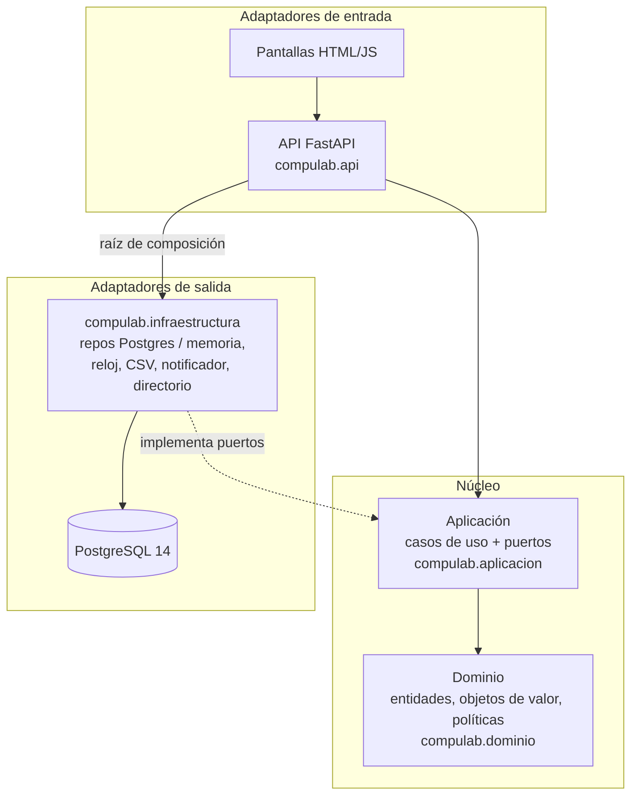
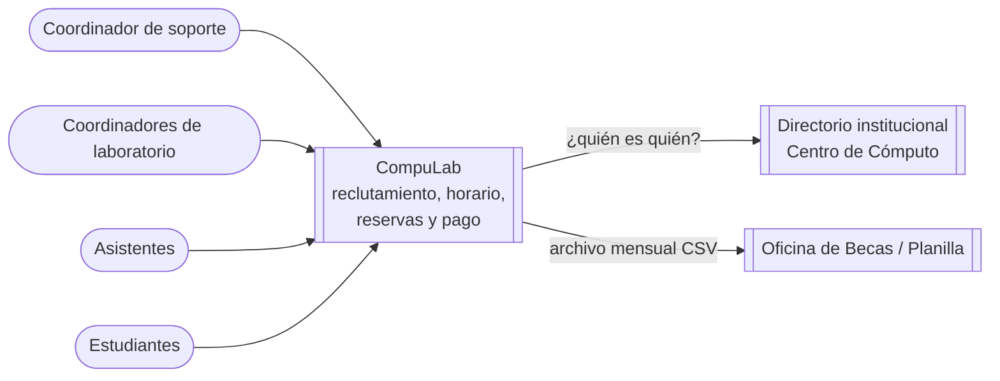
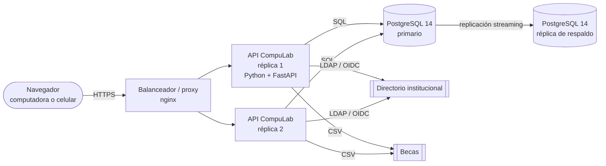
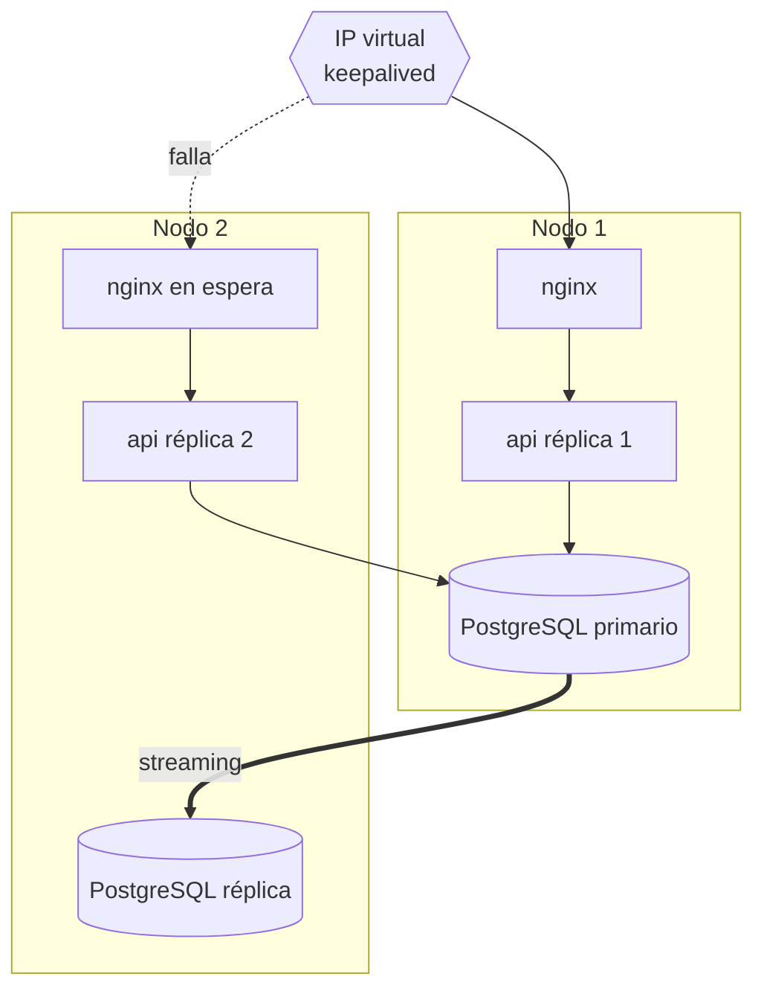

# 5. Arquitectura

## 5.1 Estilo: monolito modular con arquitectura hexagonal

**En una frase:** un solo programa desplegable (monolito). Por dentro está dividido en
módulos por tema (horario, reservas, pagos) y en capas que solo dependen *hacia
adentro*, hacia el dominio.

**Arquitectura hexagonal (puertos y adaptadores).** La idea es que las reglas del
negocio no dependan de la tecnología.

- En el **centro** está el *dominio*: las clases `Turno`, `Reserva`, `CierreMensual` y sus reglas.
- Alrededor está la *aplicación*: los casos de uso, que coordinan.
- La aplicación declara **puertos**, que son interfaces de lo que necesita del exterior: "dame los turnos de la semana", "¿qué hora es?", "exporta este cierre".
- Afuera están los **adaptadores**, que implementan esos puertos con tecnología concreta: PostgreSQL, memoria, CSV, reloj del sistema, HTTP.



**La regla de dependencia.** Las flechas solo apuntan hacia el dominio:

```
api  ──►  infraestructura  ──►  aplicacion  ──►  dominio
```

El dominio no importa nada del sistema. La aplicación no conoce PostgreSQL ni
FastAPI. La función de aptitud **FF-1** verifica esta regla en cada build (ADR-0014).

**Por qué este estilo (resumen del [ADR-0001](adr/0001-monolito-modular-hexagonal.md)):**

1. El enunciado lo pide casi literalmente:
   - "regla de dependencia entre capas";
   - "dependencias externas declaradas como interfaces e inyectadas";
   - "ningún acceso real a red, archivos o reloj dentro del dominio".
2. Las reglas son el corazón del sistema. Tenerlas aisladas permite probarlas en milisegundos y sin base de datos (AC-08).
3. Cuatro laboratorios y unos cientos de usuarios **no justifican microservicios**. Agregarían red, despliegues múltiples y consistencia eventual, sin beneficio. Un monolito modular se puede partir después si hiciera falta, porque los módulos ya están separados.

## 5.2 Vista de contexto (C4 nivel 1)



## 5.3 Vista de contenedores (C4 nivel 2)



- **API CompuLab:** sirve las pantallas (archivos estáticos) y la API JSON. **No guarda estado** entre peticiones; todo vive en PostgreSQL. Por eso se puede replicar.
- **PostgreSQL 14:** la única fuente de verdad. Además de los datos, protege las invariantes críticas (ADR-0004).
- **Tareas periódicas:** la liberación de reservas cada minuto corre dentro de cada réplica y es idempotente. El cierre del día 1 sería otra tarea igual.

## 5.4 Despliegue

**En el prototipo** (`docker-compose.yml`) hay un contenedor `db` con postgres:14 y un
contenedor `api`. Los puertos son 5440 y 8090, para no chocar con otros proyectos.

**En producción**, en la infraestructura del TEC (ADR-0015):



**Cómo responde a los atributos de calidad:**

| Atributo | Respuesta de la arquitectura |
|----------|-------------------------------|
| Disponibilidad (AC-02) | Dos réplicas sin estado en nodos distintos y PostgreSQL con réplica. Si cae un nodo, el otro sigue atendiendo. |
| Aislamiento de carga (AC-03) | Contenedores y base propios, con CPU y memoria reservadas (`deploy.resources.reservations`). No se comparte la base con matrícula. |
| Rendimiento (AC-01) | Réplicas horizontales, índices, reglas evaluadas con los datos de una semana y *pool* de conexiones (mejora prevista). |
| Integridad (AC-05) | Las transacciones y las restricciones `EXCLUDE` están en un solo primario: no hay escrituras en dos lugares. |
| Modificabilidad (AC-04) | Las tarifas son datos; las reglas y los formatos están detrás de interfaces. |

## 5.5 Estructura del código

```
src/compulab/
  dominio/            ← no importa nada de afuera (FF-1 y FF-2)
    comun/            IntervaloTiempo, SemanaISO, Mes, Dinero, Usuario, errores
    horario/          Asistente, Disponibilidad, Turno, PoliticaDeAsignacion
    reservas/         Laboratorio, Maquina, Reserva, PoliticaDeReserva
    pagos/            Tarifario, Asistencia, PoliticaDeRecargo, LiquidadorMensual, CierreMensual
  aplicacion/
    puertos.py        Protocols: repositorios, UnidadDeTrabajo, Reloj, Notificador, ExportadorPlanilla, Directorio
    casos_uso/        AsignarTurno, ResponderTurnoPendiente, ReservarMaquina, LiberarReservasNoPresentadas, CerrarMes
    consultas.py      lecturas para las pantallas (sin reglas)
  infraestructura/
    memoria/          repositorios y unidad de trabajo en memoria (también son dobles de prueba)
    postgres/         repositorios con SQL plano y unidad de trabajo transaccional
    servicios.py      RelojDelSistema, NotificadorDeRegistro, DirectorioEnMemoria
    exportador_csv.py ExportadorCsvBecas
    datos_demo.py     datos de demostración relativos a hoy
  api/
    composicion.py    raíz de composición (inyección de dependencias)
    app.py            endpoints y traducción de errores a HTTP
    esquemas.py       validación del formato de entrada y conversión a JSON
web/                  pantallas HTML/CSS/JS
db/migraciones/       001_esquema.sql
tests/                dominio/ aplicacion/ api/ aptitud/ integracion/
```

## 5.6 Mejoras previstas (fuera del prototipo)

1. *Pool* de conexiones (`psycopg_pool`) en lugar de una conexión por petición.
2. Autenticación real con el directorio (OIDC o LDAP) en lugar del selector de la demo.
3. Notificaciones por correo institucional: un adaptador nuevo de `Notificador`.
4. El cierre automático el día 1 como tarea programada.
5. Historial de topes semanales (hoy se usa el tope vigente al cerrar; ADR-0007).
6. Una herramienta de migraciones con versiones (por ejemplo, yoyo-migrations o Alembic en modo SQL) cuando haya más de un archivo de esquema.
