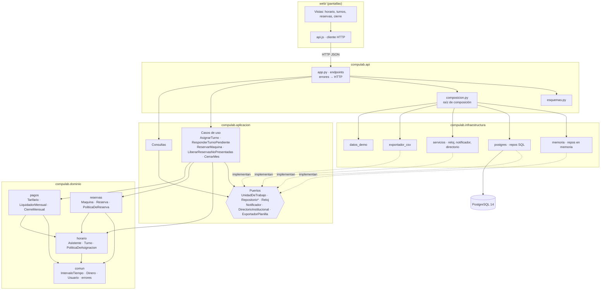

# 7. Componentes

Un **componente** es una parte del sistema con una responsabilidad clara y una interfaz
(lo que ofrece y lo que necesita). En CompuLab, los componentes son los paquetes de
Python, y las interfaces que necesitan son los **puertos**.

## 7.1 Diagrama de componentes

## 7.2 Responsabilidades

| Componente | Responsabilidad | Ofrece | Necesita |
|------------|-----------------|--------|----------|
| `web/` | Mostrar la información y recoger las acciones de cada rol; anticipar errores | Pantallas | API HTTP |
| `api.app` | Traducir HTTP ↔ comandos y consultas; traducir errores de dominio a códigos HTTP | Endpoints `/api/...` | Contenedor de casos de uso |
| `api.composicion` | Decidir qué adaptador va en cada puerto (**el único lugar** con clases concretas) | `Contenedor` | Todo |
| `aplicacion.casos_uso` | Coordinar cada operación: cargar, delegar en el dominio, guardar y avisar | `ejecutar(comando)` | Puertos |
| `aplicacion.consultas` | Lecturas para las pantallas, con permisos | Métodos de consulta | `UnidadDeTrabajo` |
| `aplicacion.puertos` | Contratos (Protocol) con el exterior | Interfaces | — |
| `dominio.horario` | Reglas de asignación: traslape, tope, disponibilidad, actividad y un responsable | `PoliticaDeAsignacion` | `dominio.comun` |
| `dominio.reservas` | Reglas de reserva: abierto, 2 h, 1 activa, 6 h, máquina libre y en servicio; liberación a los 15 min | `PoliticaDeReserva`, `Reserva` | `comun`, `horario.Turno` |
| `dominio.pagos` | Cálculo del pago: tope semanal, recargo, tarifas vigentes; cierre inmutable | `LiquidadorMensual`, `CierreMensual` | `comun`, `horario.Asistente` |
| `dominio.comun` | Tiempo, dinero, usuarios y permisos, errores | Objetos de valor | Solo la biblioteca estándar |
| `infraestructura.postgres` | Persistencia transaccional y traducción de restricciones a errores de dominio | Implementa los repositorios y `UnidadDeTrabajo` | psycopg, PostgreSQL |
| `infraestructura.memoria` | Persistencia en memoria con transacciones (demo y dobles de prueba) | Ídem | — |
| `infraestructura.servicios` | Reloj real, avisos (log) y directorio simulado | `Reloj`, `Notificador`, `DirectorioInstitucional` | zoneinfo, logging |
| `infraestructura.exportador_csv` | Formato del archivo para Becas | `ExportadorPlanilla` | csv, disco |

## 7.3 Interfaces (puertos)

Están definidas en `src/compulab/aplicacion/puertos.py`:

| Puerto | Operaciones | Adaptadores |
|--------|-------------|-------------|
| `UnidadDeTrabajo` | `__enter__`, `__exit__`, `confirmar()` y los 8 repositorios | `UnidadDeTrabajoPostgres`, `UnidadDeTrabajoEnMemoria` |
| `RepositorioTurnos` | `siguiente_id`, `obtener`, `agregar`, `actualizar`, `del_asistente_en`, `del_laboratorio_en`, `pendientes_del_asistente` | Postgres, memoria |
| `RepositorioReservas` | `siguiente_id`, `agregar`, `actualizar`, `de_maquina_en`, `del_estudiante_en`, `activas_del_estudiante`, `sin_presentarse` | Postgres, memoria |
| `RepositorioAsistentes` | `obtener(id, bloquear)`, `listar`, `agregar` | Postgres (`FOR UPDATE`), memoria |
| `RepositorioAsistencias`, `RepositorioTarifarios`, `RepositorioCierres`, `RepositorioLaboratorios`, `RepositorioMaquinas` | Lecturas y altas | Postgres, memoria |
| `Reloj` | `ahora()` | `RelojDelSistema`, `RelojFijo` (prueba) |
| `Notificador` | `notificar(destinatario, asunto, mensaje)` | `NotificadorDeRegistro`, `NotificadorEspia` (prueba) |
| `DirectorioInstitucional` | `buscar(id)`, `listar()` | `DirectorioEnMemoria` |
| `ExportadorPlanilla` | `exportar(cierre) -> str` | `ExportadorCsvBecas`, `ExportadorEspia` (prueba) |

## 7.4 API HTTP

| Método y ruta | Caso de uso o consulta | Quién |
|---------------|------------------------|-------|
| `POST /api/turnos` | CU-07 Asignar turno | Coordinadores |
| `POST /api/turnos/{id}/respuesta` | CU-08 Responder turno | Asistente del turno |
| `GET /api/laboratorios/{id}/horario?fecha=` | Horario semanal | Coordinador de ese laboratorio o de soporte |
| `GET /api/asistentes?fecha=` | Carga semanal de cada asistente | Coordinadores |
| `GET /api/mis-turnos` | Turnos propios | Asistente |
| `POST /api/reservas` | CU-15 Reservar máquina | Estudiantes |
| `GET /api/laboratorios/{id}/ocupacion?fecha=` | Franjas abiertas y máquinas | Todos |
| `GET /api/mis-reservas` | Reservas propias | Estudiantes |
| `POST /api/cierres` | CU-19 Cerrar el mes | Coordinador de soporte |
| `GET /api/cierres`, `GET /api/cierres/{a}/{m}`, `GET /api/cierres/{a}/{m}/archivo` | Historial, detalle y CSV | Coordinador de soporte |
| `GET /api/usuarios`, `GET /api/yo`, `GET /api/laboratorios`, `GET /api/salud` | Sesión simulada, avisos, catálogo y *health check* | Todos |

**Errores:** responden JSON `{"codigo": "E-...", "mensaje": "..."}`. El código HTTP
depende del tipo de error:
- 403: no autorizado;
- 404: no encontrado;
- 422: dato inválido;
- 409: una regla del negocio impide la operación.

La documentación interactiva queda en `/docs` (OpenAPI).
