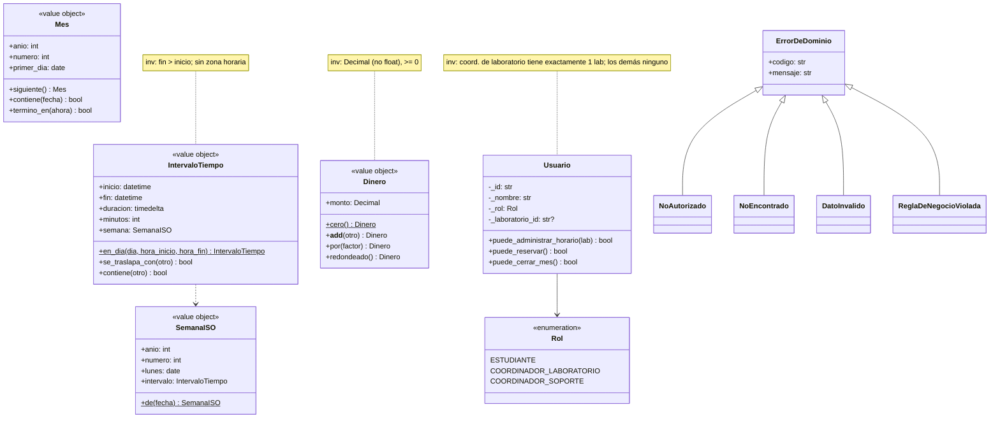
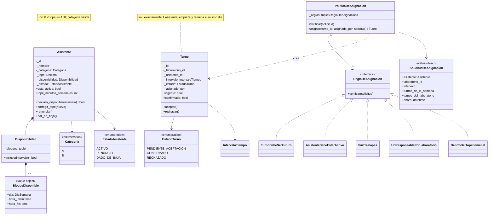
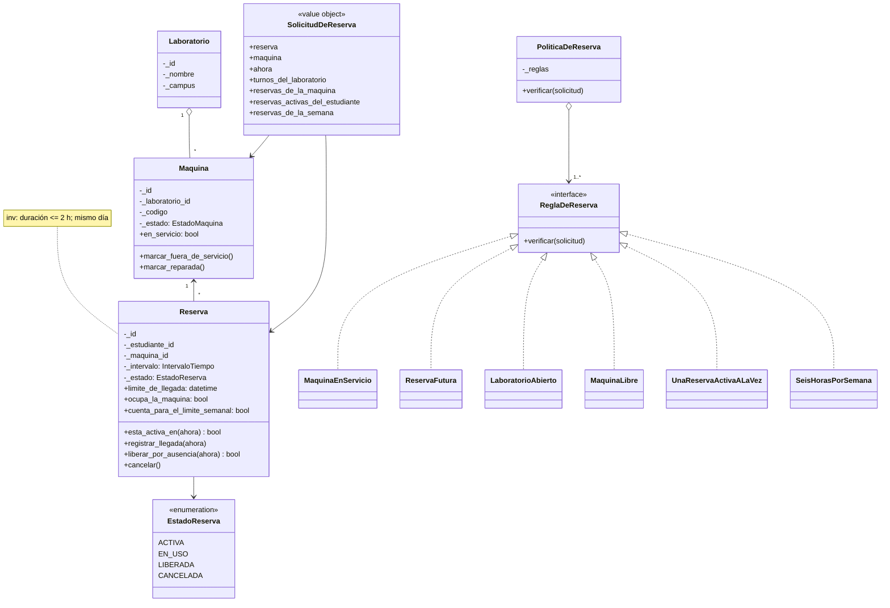
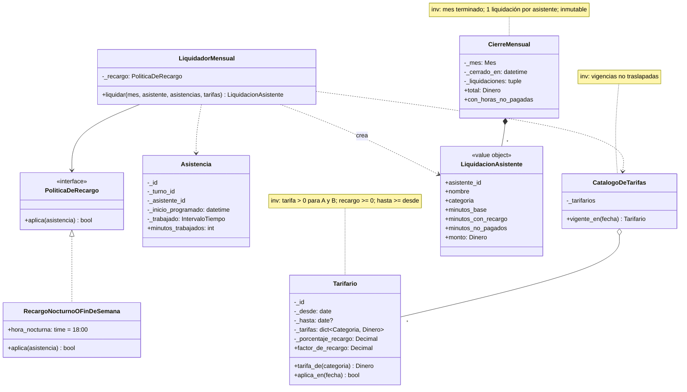
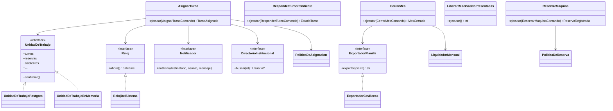

# 8. Clases

## 8.1 Convenciones del modelo de dominio

- **Entidades.** Tienen identidad propia (`id`) y estado que cambia: `Asistente`, `Turno`, `Reserva`, `Maquina`, `Tarifario`, `Asistencia`, `CierreMensual` y `Usuario`.
  - Sus **atributos son privados** (`self._estado`) y se leen con propiedades de solo lectura.
  - El estado **solo cambia con métodos que verifican la regla**: `turno.aceptar()`, `reserva.liberar_por_ausencia(ahora)`.
  - Dos entidades son iguales si tienen el mismo `id`.
- **Objetos de valor.** No tienen identidad y son inmutables: `IntervaloTiempo`, `SemanaISO`, `Mes`, `Dinero`, `BloqueDisponible`, `LiquidacionAsistente`.
  - Son `@dataclass(frozen=True)`: cualquier intento de asignar un atributo lanza `FrozenInstanceError`.
- **Invariantes en el constructor.** Ningún objeto inválido llega a existir. Si los datos rompen una regla, el constructor lanza un `ErrorDeDominio`.
- **Sin modelo anémico.** Las clases con reglas tienen comportamiento, no solo datos. Un modelo anémico son clases con getters y setters y la lógica en "servicios". Solo `Laboratorio` es un contenedor de datos simple, porque no tiene reglas.

## 8.2 Dominio: común

`cubren(intervalos, objetivo)` es una función del módulo `tiempo`. Responde si un
conjunto de intervalos cubre otro **sin huecos**. Se usa para saber si un laboratorio
está abierto toda una reserva y si un turno está dentro de la disponibilidad.

## 8.3 Dominio: horario

## 8.4 Dominio: reservas

## 8.5 Dominio: pagos

## 8.6 Aplicación

Los **comandos** (`AsignarTurnoComando`…) y los **resultados** (`TurnoAsignado`…) son
dataclasses inmutables: son los datos que cruzan la frontera del caso de uso.

## 8.7 Tabla de invariantes

| Clase | Invariante | Error | Prueba |
|-------|------------|-------|--------|
| `IntervaloTiempo` | fin > inicio; sin zona horaria | `E-INTERVALO-INVALIDO`, `E-DATO-INVALIDO` | `tests/dominio/test_comun.py::TestIntervaloTiempo` |
| `Dinero` | Decimal y >= 0 | `E-DATO-INVALIDO` | `TestDinero` |
| `Mes`, `SemanaISO` | Existen en el calendario | `E-DATO-INVALIDO` | `TestSemanaYMes` |
| `Usuario` | Un coordinador de laboratorio tiene exactamente 1 laboratorio | `E-DATO-INVALIDO` | `TestUsuario` |
| `Asistente` | 0 < tope ≤ 168, Decimal, categoría A o B | `E-DATO-INVALIDO` | `tests/dominio/test_horario.py::TestAsistente` |
| `Turno` | Exactamente un asistente; mismo día; transiciones solo desde PENDIENTE | `E-DATO-INVALIDO`, `E-TRANSICION-INVALIDA` | `TestTurno` |
| `Reserva` | ≤ 2 h; mismo día; llegada dentro de los 15 min | `E-RESERVA-MUY-LARGA`, `E-TRANSICION-INVALIDA` | `tests/dominio/test_reservas.py` |
| `Tarifario` | Tarifa > 0 para A y B; recargo ≥ 0; vigencia coherente | `E-DATO-INVALIDO` | `tests/dominio/test_pagos.py::TestTarifario` |
| `CatalogoDeTarifas` | Vigencias sin traslape | `E-DATO-INVALIDO` | ídem |
| `LiquidacionAsistente` | Horas ≥ 0; sin horas pagadas no hay monto | `E-DATO-INVALIDO` | `TestLiquidacionYCierre` |
| `CierreMensual` | Mes terminado; 1 liquidación por asistente; sin métodos que lo modifiquen | `E-MES-NO-TERMINADO`, `E-DATO-INVALIDO` | ídem |
