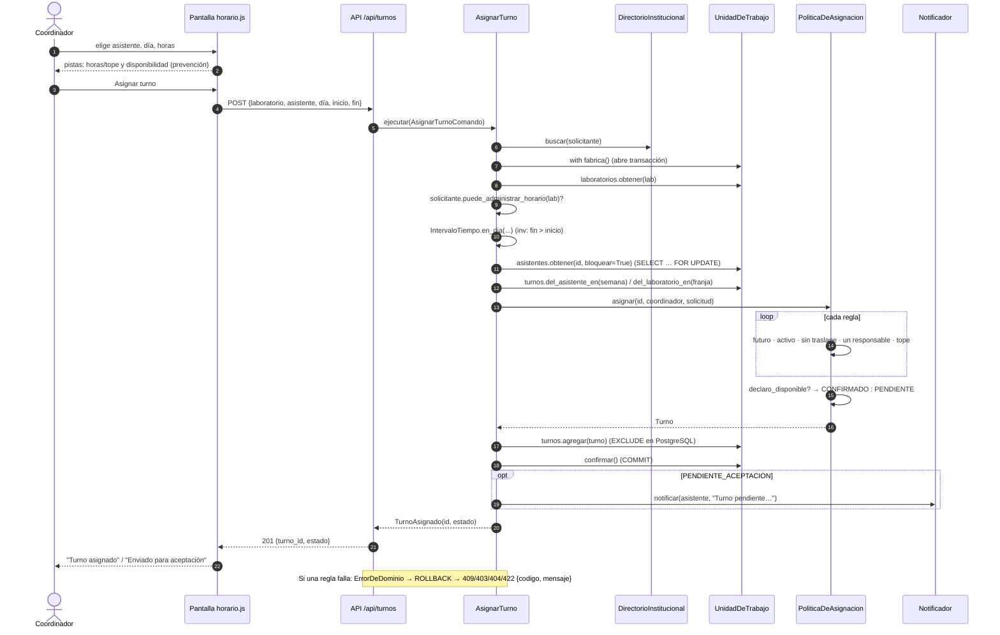
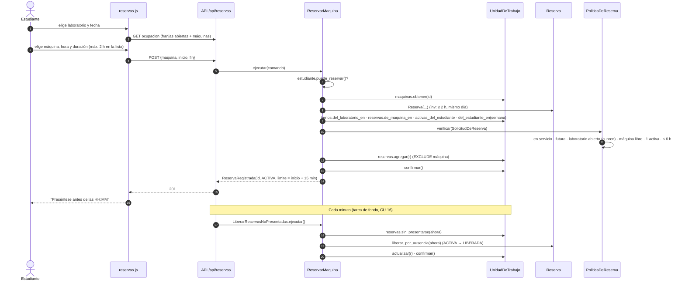
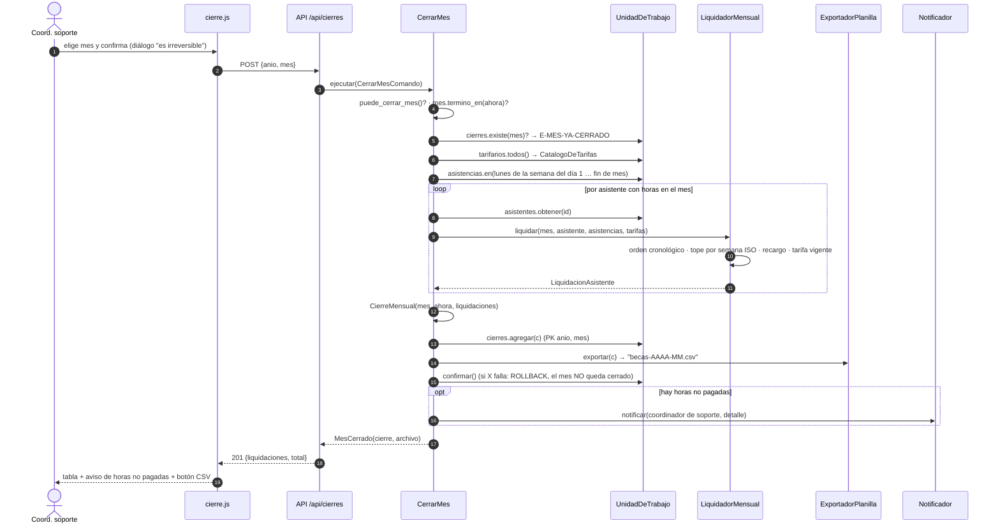
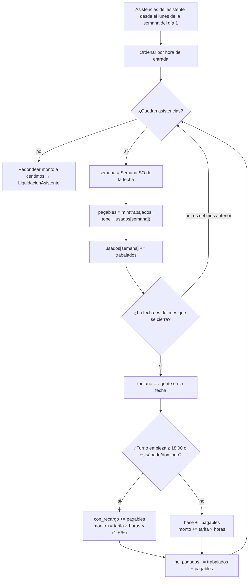
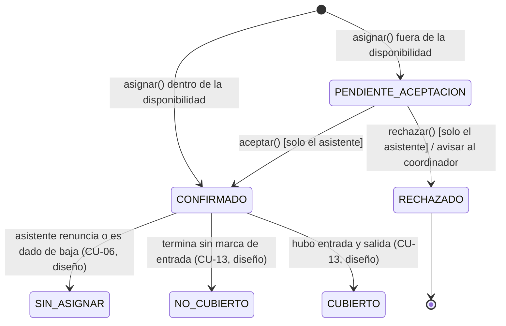
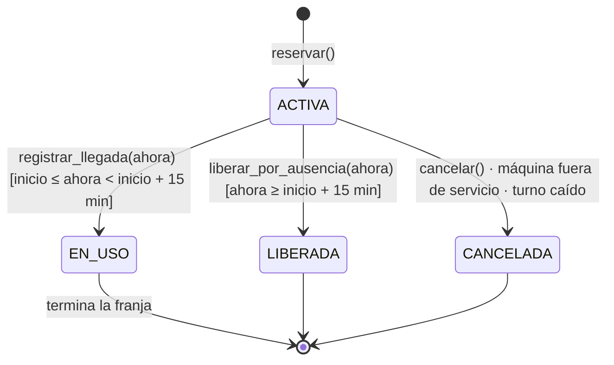
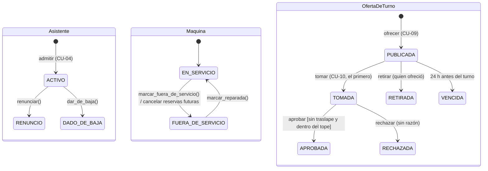

# 9. Comportamiento

Hay dos tipos de diagrama en esta sección:

- **Diagramas de secuencia:** muestran *quién llama a quién* en cada caso de uso implementado.
- **Diagramas de estado:** muestran *cómo cambia* cada entidad.

## 9.1 Secuencia · CU-07 Asignar turno

## 9.2 Secuencia · CU-15 Reservar máquina (y CU-16)

## 9.3 Secuencia · CU-19 Cerrar el mes

## 9.4 Actividad · cálculo de una liquidación

## 9.5 Estados · Turno

Implementados: PENDIENTE_ACEPTACION, CONFIRMADO y RECHAZADO. Los demás estados
pertenecen a casos de uso diseñados pero no programados.

## 9.6 Estados · Reserva

## 9.7 Estados · Asistente, Máquina y Oferta de turno

La `OfertaDeTurno` está diseñada pero no implementada. Al aprobarla se **reutiliza**
la `PoliticaDeAsignacion` con las reglas `SinTraslapes` y `DentroDelTopeSemanal`
(ver [10-patrones.md](10-patrones.md)).
