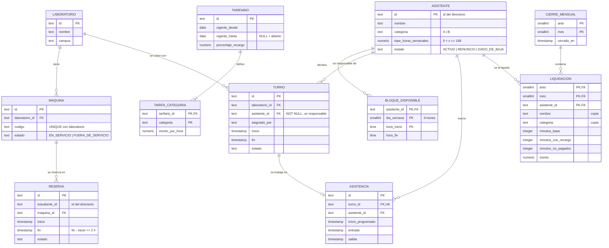

# 15. Diseño de la base de datos

- **Motor:** PostgreSQL 14 (restricción R-02).
- **Esquema:** [`db/migraciones/001_esquema.sql`](../db/migraciones/001_esquema.sql).
- **Carga del esquema:** Postgres lo ejecuta solo la primera vez que crea la base. El archivo se monta en `/docker-entrypoint-initdb.d`.

## 15.1 Modelo entidad-relación

## 15.2 Decisiones de modelado

| Decisión | Por qué |
|----------|---------|
| **Ids de texto** (`'T-15'`, `'A-01'`) | Los ids de personas vienen del directorio institucional, que usa texto. Turnos y reservas usan secuencias (`turno_numero`, `reserva_numero`) con prefijo, para que se lean en los logs. |
| **Sin tabla de usuarios** | Quién es quién lo dice el directorio (ADR-0011). `reserva.estudiante_id` y `turno.asignado_por` guardan el id del directorio sin llave foránea. |
| **Disponibilidad en una tabla aparte** (`bloque_disponible`) | Un asistente declara de 0 a N bloques. Es primera forma normal: nada de listas en una columna. |
| **Asistencia separada de turno**, con `inicio_programado` copiado | Se paga lo trabajado (entrada y salida), pero el recargo depende del inicio programado (ADR-0008). Copiarlo hace la asistencia autocontenida para el cálculo. |
| **`liquidacion` copia el nombre y la categoría** | Es una desnormalización intencional: el cierre es un **documento histórico** inmutable. Si mañana cambia el nombre o la categoría, el cierre de octubre debe seguir diciendo lo que se pagó. |
| **Minutos enteros en `liquidacion`** | Exactos y sin redondeos intermedios. Las horas se calculan al mostrar. |
| **`numeric` para montos y porcentajes** | Es exacto; corresponde al `Decimal` del dominio (ADR-0006). |
| **`timestamp without time zone`** | Hora local de Costa Rica (ADR-0009). |
| **Estados como `text` con `CHECK`** en lugar de tipos `ENUM` | Agregar un estado es cambiar un CHECK, sin `ALTER TYPE`. Además se lee igual que el enum de Python. |

## 15.3 Restricciones que protegen invariantes (ADR-0004)

| Restricción | Tabla | Invariante | Error de dominio al violarla |
|-------------|-------|------------|------------------------------|
| `turno_sin_traslape_del_asistente` — `EXCLUDE USING gist (asistente_id WITH =, tsrange(inicio, fin) WITH &&) WHERE estado <> 'RECHAZADO'` | turno | Un asistente no tiene dos turnos simultáneos, en ningún laboratorio | `E-TRASLAPE` |
| `turno_un_responsable_por_laboratorio` — ídem con `laboratorio_id` | turno | Un laboratorio no tiene dos turnos simultáneos | `E-LABORATORIO-CUBIERTO` |
| `CHECK (inicio::date = fin::date)` | turno, asistencia | Empieza y termina el mismo día | — |
| `reserva_sin_traslape_en_maquina` — `EXCLUDE … (maquina_id WITH =, tsrange WITH &&) WHERE estado IN ('ACTIVA','EN_USO')` | reserva | Una máquina no se reserva dos veces; las liberadas y canceladas no bloquean | `E-MAQUINA-OCUPADA` |
| `CHECK (fin - inicio <= interval '2 hours')` | reserva | Máximo 2 horas | — |
| `tarifario_sin_vigencias_traslapadas` — `EXCLUDE … (daterange(desde, hasta, '[]') WITH &&)` | tarifario | Hay un solo tarifario vigente por fecha | — |
| `PRIMARY KEY (anio, mes)` | cierre_mensual | Un mes se cierra una vez | `E-MES-YA-CERRADO` |
| Triggers `cierre_mensual_inmutable` y `liquidacion_inmutable` | cierre_mensual, liquidacion | "Un mes cerrado no se vuelve a calcular ni se corrige" | Error de integridad |
| `turno.asistente_id NOT NULL` | turno | "No existen turnos sin asistente" | — |

**Qué es `EXCLUDE USING gist`.** Es una generalización de `UNIQUE`. En lugar de "no
puede haber dos filas con el mismo valor", dice "no puede haber dos filas en que *todas*
estas comparaciones sean verdaderas". Por ejemplo: mismo asistente (`=`) **y** rangos
de tiempo que se traslapan (`&&`).

- `tsrange(inicio, fin)` construye un rango `[inicio, fin)`, así que dos turnos seguidos no chocan.
- La extensión `btree_gist` permite combinar `=` sobre texto con `&&` sobre rangos en el mismo índice GiST.

**Qué queda solo en el dominio:**
- el **tope semanal**, que es una suma; se protege con `SELECT … FOR UPDATE` (ADR-0005);
- la **disponibilidad**;
- la regla de **una reserva activa** y el límite de **6 h**, que dependen de "ahora".

## 15.4 Índices

| Índice | Consulta que acelera |
|--------|----------------------|
| GiST de las restricciones EXCLUDE | Búsquedas de traslape por asistente, laboratorio o máquina |
| `turno_por_asistente (asistente_id, inicio)` | Turnos del asistente en la semana (tope) |
| `reserva_por_estudiante (estudiante_id, inicio)` | Reservas del estudiante en la semana (6 h) |
| `reserva_activas (inicio) WHERE estado = 'ACTIVA'` | Liberación cada minuto (índice parcial, pequeño) |
| `asistencia_por_entrada (entrada)` | Asistencias del periodo al cerrar el mes |

## 15.5 Tablas de los casos de uso diseñados (no implementadas)

| Tabla | Columnas principales | CU |
|-------|----------------------|----|
| `convocatoria` | id, semestre, abre, cierra | CU-01 |
| `postulacion` | id, convocatoria_id, estudiante_id, laboratorios[], estado | CU-02, CU-04 |
| `bloque_postulado` | postulacion_id, dia_semana, hora_inicio, hora_fin | CU-02 |
| `entrevista` | postulacion_id, entrevistador_id, fecha, resultado | CU-03 |
| `oferta_turno` | id, turno_id, ofrecido_por, tomado_por, estado, vence_en | CU-09 a CU-12 |
| `cambio_maquina` | maquina_id, estado, registrado_por, en | CU-17, CU-18 (historial para el reporte) |

## 15.6 Pruebas de la base

`tests/integracion/test_postgres.py` crea un **esquema temporal** por prueba
(`prueba_xxxxxxxx`), aplica `001_esquema.sql` y lo borra al terminar. Verifica:

- el mapeo de filas a objetos del dominio;
- las tres restricciones `EXCLUDE`, *saltándose* el dominio a propósito;
- el trigger de inmutabilidad;
- el rollback de lo no confirmado;
- dos casos de uso de punta a punta contra PostgreSQL real.
